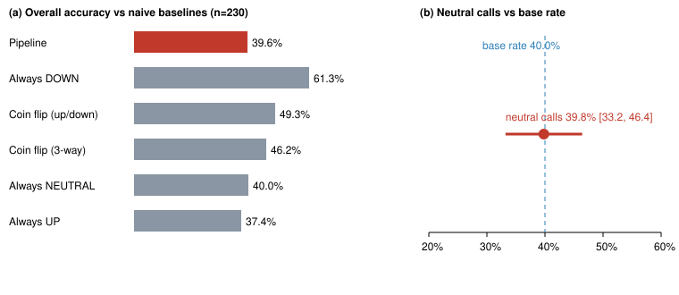

<!-- DRAFT v1. All numbers come from analysis/final_results.py -> paper/results.json (frozen set, n=230). References verified against arXiv/DOI/publisher records 2026-10-21. -->

# A Multi-Agent LLM News Pipeline Collapses to Near-Constant Abstention and Shows No Detectable Edge: A Prospective Negative Result

**Prasoon Kumar Kashyap**
Manipal Institute of Technology, Bengaluru
October 2026

---

## Abstract

LLM agents that read news and call short-horizon market direction are easy to build, and many people are building them. We test one such system prospectively, against a protocol we wrote down in advance. A four-stage multi-agent pipeline (factor mapping, parallel news research, signal synthesis, prediction) made UP / DOWN / NEUTRAL calls on 55 liquid assets, which we scored against realized prices after 5–7 days. Prompts and models were frozen and hashed before collection. Across 230 scored predictions (logged 29 Aug – 3 Oct 2026) the pipeline was 39.6% accurate under the standard ±2% neutral band, below always-DOWN (61.3%, a falling-market artifact), a coin flip (49.3%) and always-NEUTRAL (40.0%). The main reason is that the system nearly always abstains: 85% of its calls are NEUTRAL, so its accuracy is almost exactly that of the constant "always neutral" predictor (neutral calls 39.8% correct, versus a 40.0% base rate of flat outcomes). The 34 directional calls were 38.2% correct (95% CI 23.5–55.9%, p = 0.23), which is too few to say anything firm: with n = 34, a two-sided test at α = 0.05 has 80% power only against a true accuracy of about 74%, so only a very large edge (about 24 points over chance) could have been detected. A pre-specified mechanism hypothesis (the system chases momentum that then reverses) was only half supported: it chased recent momentum in 62% of directional calls, and chasing calls did worse (33% vs 46%), but momentum did not reverse (46% reversal). We found no evidence of edge. We also stress that the study has limited power to detect modest skill, covers one window of about six weeks in a falling market, and stopped before its sample-size target.

## 1. Introduction

Connecting a language model to a news feed and asking it for a market call is now a weekend project, and a growing research literature builds multi-agent LLM trading systems (Section 2). Efficient-market theory (Fama, 1970) says public news is already priced, so a system built on public news should earn little. Published evidence on LLMs and returns is mixed and difficult to interpret, in part because most of it comes from backtests on historical data that the models may have seen during training (Glasserman & Lin, 2023; Lopez-Lira et al., 2025). A prospective test, in which every prediction is logged before the outcome exists, avoids that problem.

This paper reports such a test of one concrete system. We make a modest claim. It is a clean, honestly reported negative result for one pipeline in one setting, consistent with what market-efficiency arguments predict. It is not evidence that no LLM system can ever predict markets. We report what was planned, what changed, and where the study is weak, because the value of a null result depends on that.

**Contributions.** (i) A prospective, frozen-configuration evaluation with 230 scored predictions across stocks, ETFs, commodities and crypto. (ii) The finding that the system's behavior reduces to near-constant abstention, so its accuracy reduces to a base rate. (iii) A pre-specified momentum-chasing analysis that is only partly supported. (iv) Code and data to reproduce every number.

## 2. Related work

**LLM trading agents.** Finance-specific language models such as FinGPT (Yang et al., 2023) were quickly followed by agent systems that add memory, tools and role structure: FinMem uses layered memory and a configurable trader profile (Yu et al., 2024a), FinAgent is a multimodal, tool-augmented trading agent (Zhang et al., 2024), FinCon organizes agents in a manager–analyst hierarchy with verbal reinforcement (Yu et al., 2024b), and TradingAgents simulates a trading firm with analyst, researcher, trader and risk-management roles (Xiao et al., 2024). Our pipeline belongs to this family. These systems are typically evaluated on historical backtests and report gains over baselines. More recent evaluations are less favorable. Over two decades and more than 100 symbols, the advantages reported for LLM timing strategies largely disappear, with strategies too conservative in bull markets and too aggressive in bear markets (Li et al., 2026). On StockBench, most LLM agents fail to beat buy-and-hold, and strong financial question-answering does not translate into trading performance (Chen et al., 2025). LiveTradeBench runs 21 LLMs in a 50-day live environment and finds that general benchmark rank does not predict trading outcomes (Yu, Li & You, 2025). Our study is closest to this last line of work: it is prospective, but it scores a single frozen system against naive baselines and analyzes its abstention behavior rather than ranking models.

**Look-ahead bias.** Lopez-Lira and Tang (2023) report that ChatGPT sentiment scores of news headlines predict subsequent stock returns. Backtests of this kind are hard to interpret. A model whose training data overlaps the test period may already know what happened, and its prior knowledge of company names can distort its reading of a headline (Glasserman & Lin, 2023). LLMs can recall exact economic and financial figures from before their training cutoff, and instructing them to ignore dates or masking entity names does not prevent this (Lopez-Lira et al., 2025). One response is to train models only on text available at each point in time (He et al., 2025). Ours is the other response: we make predictions before the outcome exists, so leakage is impossible by construction.

**Prospective forecasting with LLMs.** Outside finance, forecasting research has converged on the same design. Halawi et al. (2024) evaluate a retrieval-augmented LLM forecaster on questions that resolve after the model's training cutoff and find it approaches the human crowd. ForecastBench continuously generates questions with unknown answers and finds that expert human forecasters still outperform the best LLMs (Karger et al., 2025). In a real-world forecasting tournament, GPT-4's forecasts were not distinguishable from a constant 50% baseline (Schoenegger & Park, 2023), a pattern close to our near-constant NEUTRAL output. Paleka et al. (2025) catalogue ways in which even nominally prospective evaluations can leak information. We follow this literature in logging every prediction before its outcome and in fixing the system configuration beforehand, in the spirit of preregistration (Nosek et al., 2018).

**Selective prediction and abstention.** A NEUTRAL call can be read as an abstention. The trade-off between errors and rejections goes back to Chow (1970), and selective classification formalizes it as a risk–coverage trade-off: a classifier may abstain on some inputs in exchange for lower error on those it covers (El-Yaniv & Wiener, 2010; Geifman & El-Yaniv, 2017). Abstention is only useful if the model abstains on the right inputs. Kamath et al. (2020) show that abstaining on low softmax confidence fails under domain shift, and a recent survey reviews the many ways LLMs are made to abstain and the open questions about when abstention reflects real uncertainty (Wen et al., 2025). Our setting differs from the standard one in that NEUTRAL is also a scored outcome, but the central question is the same: does the system abstain where it is likely to be wrong? We test this directly in Section 4.2.

**Markets and news.** Under the efficient-market hypothesis, public information is reflected in prices quickly (Fama, 1970). News content does carry short-lived information: pessimistic media coverage predicts downward price pressure followed by reversal (Tetlock, 2007), and individual stock returns show short-horizon reversals at monthly and weekly frequencies (Jegadeesh, 1990; Lehmann, 1990). These reversal results motivate our momentum-chasing hypothesis H3.

## 3. System and protocol

**Pipeline.** For each asset the system (1) asks a mapper model for five external factors that could move the asset, (2) has five researcher models each fetch Google News RSS results for one factor and summarize them, (3) has a synthesizer model score each signal 1–3 and drop low-scoring noise, and (4) has a predictor model output UP, DOWN or NEUTRAL with a stated counter-argument. Structured context (3-day price momentum, volume anomaly, upcoming earnings, VIX regime, insider and analyst data) is also provided. Mapper, synthesizer and predictor use `openai/gpt-oss-120b`, and researchers use `openai/gpt-oss-20b`, run through Groq with low reasoning effort and temperature 0.3. If any stage fails, a single-call fallback is used.

**Freeze.** The five prompts and two model IDs were hashed (`config_hash = ee2fcffc74f5`) and the hash was stamped on every record, along with the pipeline version `1.0-frozen`. The confirmatory set contains only records with that version and hash.

**Subjects.** 55 assets chosen for liquidity and news coverage before any outcomes existed: the 230 records split into 159 stock, 12 ETF, 24 commodity and 35 crypto predictions.

**Scoring.** Each prediction logs the baseline price at prediction time. After the check window (7 days; 5 for crypto) the outcome price is the close on the check date. UP is correct if price rose, DOWN if it fell, and NEUTRAL if the absolute move was within ±2%. As a robustness check (pre-specified) we also use a volatility-scaled band: NEUTRAL is correct if the absolute move is at most σ·√w, where σ is the asset's recent daily return standard deviation stored at prediction time and w is the window length in days. Predictions that went overdue were scored at the close on their own check date, never at a later price. All 95% intervals for proportions are percentile bootstrap intervals (5,000 resamples, fixed seed); the directional test is an exact two-sided binomial test against 0.5; coin-flip baselines are exact expected values (the mean of the corresponding constant strategies), not simulations.

**Arms.** The default arm was ungated (198 records). In a gated arm (32 records) a deterministic catalyst gate forced directional calls to NEUTRAL unless earnings, insider activity or a historical base rate supported them. The gated arm produced no directional calls.

**Hypotheses (pre-specified).** H1: the pipeline does not beat the best naive baseline, and its neutral calls do not beat the base rate of flat outcomes. H2: directional accuracy is not above 50%. H3: the system chases prior 3-day momentum (>50%) and that momentum reverses (>50%).

## 4. Results

Collection ran from 29 August to 3 October 2026 (last check dates 8 October). All 230 frozen predictions are scored.

### 4.1 Overall accuracy

| Strategy | Accuracy (±2% band) | Accuracy (vol-scaled band)* |
|---|---|---|
| **Pipeline** | **39.6%** | **69.9%** |
| Always DOWN | 61.3% | 61.6% |
| Coin flip (up/down) | 49.3% | 49.3% |
| Coin flip (3-way) | 46.2% | 58.2% |
| Always NEUTRAL | 40.0% | 76.0% |
| Always UP | 37.4% | 37.1% |

*229 records; one record lacks a stored σ. The vol-scaled band is wider than ±2% for most assets, so flat outcomes are more common and any neutral-heavy strategy scores higher.

*Figure 1. (a) Overall accuracy of the pipeline and naive baselines (±2% band). (b) Accuracy of the pipeline's neutral calls with 95% bootstrap CI, against the base rate of flat outcomes.*

Under the ±2% band the pipeline is below every naive baseline except always-UP, and within half a point of always-NEUTRAL. Under the vol-scaled band it beats always-DOWN, always-UP and both coin flips only because it says NEUTRAL so often, and it still trails always-NEUTRAL by about six points (69.9% vs 76.0%). Always-DOWN scores highest because 61% of the 230 outcomes were negative (a falling market over this window). We do not read it as a viable strategy. It shows that headline accuracy in a short window mostly reflects the market's direction.

### 4.2 The system is almost a constant predictor

The pipeline called NEUTRAL in 196 of 230 cases (85%). Those calls were correct 39.8% of the time (95% CI 33.2–46.4%), against a base rate of flat outcomes of 40.0% (75.4% vs 76.0% under the vol-scaled band). Because neutral calls are 85% of the sample, this is nearly identical to the constant predictor by construction, so we do not treat "neutral accuracy ≈ base rate" as a stand-alone test. The informative question is whether the cases where the system departs from NEUTRAL differ from the rest. Outcomes were flat 41.2% of the time when it went directional and 39.8% when it said NEUTRAL, a difference of −1.4 points. A percentile bootstrap that resamples whole logging dates (13 dates, 4,000 resamples) gives a 95% CI of −20 to +25 points for that difference, and a one-sided exact (hypergeometric) test of whether the neutral calls were selected better than random draws from the 230 gives p = 0.64. We therefore find no evidence that the system chooses when to abstain well. Because only 34 cases were non-neutral, we also cannot rule out a moderate effect (Section 6).

Splits were similar across subgroups. The ungated arm matches its own always-neutral baseline (40.9% vs 41.4%). The gated arm is identical to always-neutral by design (31.2%). Crypto neutral calls were 27.6% correct (n = 29) against a 28.6% base rate; crypto moved far more than 2% in this window.

### 4.3 Directional calls (H2)

There were 34 directional calls (25 UP, 9 DOWN), of which 13 were correct: **38.2%, 95% CI 23.5–55.9%, exact binomial p = 0.23 against 50%**. UP calls were 9/25 and DOWN calls 4/9. The point estimate is below chance but the interval includes 50%. We do not claim the calls are worse than chance. We only note that this sample cannot show they are better. A power calculation makes the limit concrete: for a two-sided test against 50% at α = 0.05, 80% power with n = 34 requires a true accuracy of about 74% under the normal approximation (about 75% for the exact binomial test, whose discreteness makes it conservative). That is an edge of roughly 24 points, far larger than any edge plausible for a system trading on public news. Clustering of calls by date (Section 6) raises the minimum detectable effect further. The pre-specified target of about 200 directional calls was not reached (Section 5).

### 4.4 Mechanism (H3): partly supported

Of the 34 directional calls, 21 (62%) matched the direction of the prior 3-day move, so the system does chase recent momentum. Chasing calls were correct 33% of the time (n = 21) versus 46% for calls that fought the prior move (n = 13), which points the expected way but is based on very few calls. The second half of H3 failed. Across all 227 records with recoverable prior momentum, the prior move continued in 54% of cases and reversed in 46%. So the data do not support the story that the system chases moves that then bounce back. A more defensible description is that it treats recent momentum as a signal when momentum carries no predictive value here.

### 4.5 Pilot data

An earlier exploratory pilot (179 scored predictions, with prompts, models and architecture still changing) shows the same pattern: 41.9% overall against 43.6% for always-NEUTRAL, and 40.3% directional accuracy (CI 29.9–50.6%, n = 77). We use it only as motivation and exclude it from every confirmatory number.

## 5. Deviations from the pre-registration

We list these in full because several favor a weaker study, and some readers may weigh them.

1. **Self-registered.** The protocol was written as a dated document in the project folder before collection. It was not filed with an independent registry and the project was not under version control, so its timestamps are not externally verifiable.
2. **Stated before any frozen outcome was scored:** the subject list grew from 33 to 55 and the default arm changed to ungated, to increase throughput and directional volume. The primary claim (H1) was reframed around value over naive baselines and abstention because the pilot had already shown near-constant abstention. The pilot results were seen before that reframe.
3. **Early stop.** The original rule was 500 predictions or 12 weeks. It was revised on 9 September, after interim results had been seen, to end collection on 7 October. We stopped at 230 scored predictions (about 330 expected at the revised stop) and only 34 directional calls (about 200 targeted). Stopping early on a null result lowers power and cannot create significance, but it means H2 is underpowered and the study should be read as unable to detect small effects.
4. **Late scoring.** Collection was manual for part of the period, and some predictions went overdue. They were scored at the close on their check date through a backfill script, never at a later price.
5. **Code edited during collection.** The pipeline source file was last modified on 6 September, after the first confirmatory record (29 August). The configuration hash, which covers the five prompts and two model IDs, is identical on all 230 records, so the prompts and models were not changed. Edits outside the hash (for example the default arm, the subject list or batch-size limits) were permitted by the protocol, but without version control we cannot reconstruct exactly what changed on that date.
6. **Minor.** The gated arm has 32 records (not 33 as stated in the protocol). One record lacks a stored σ and is excluded from the vol-scaled analysis only.

## 6. Limitations

- **Power.** Only 34 directional calls, spread over 13 logging dates, with assets moving together. We can say there is no evidence of skill, not that skill is absent. Only an edge of roughly 24 points or more over 50% (true accuracy ≈ 74%) had an 80% chance of being detected at α = 0.05 (two-sided), and that is before accounting for clustering by date, which raises the threshold further. Edges of a few points, the most plausible size, were essentially undetectable.
- **Regime.** One window of about six weeks, with 61% of outcomes negative. Results may differ in other regimes.
- **Scope.** One pipeline, one model family (gpt-oss through a free-tier provider), free public news (Google News RSS, Finnhub), and 5–7 day horizons. Intraday, longer-horizon, or paid-data systems are not tested.
- **Subject selection.** Assets are large and liquid, which are the hardest cases for any edge. A less efficient corner might behave differently.
- **Scoring noise.** Outcomes use a single close price, and the fixed ±2% neutral band is arbitrary (hence the vol-scaled robustness check). Transaction costs and position sizing were not modeled.
- **Non-independence.** Predictions on the same date share market moves, so the effective sample size is smaller than n.

## 7. Conclusion

A multi-agent LLM news pipeline, evaluated prospectively with frozen prompts, effectively reduced to saying "neutral" for nearly every asset, and matched the accuracy of that constant guess. Its rare directional calls were no better than chance within a wide interval, and the popular story that it chases moves that reverse was not supported. This is the outcome efficient-market reasoning predicts, and it cautions against taking demos of this kind as evidence of edge. We encourage others to evaluate such systems prospectively, against naive baselines, with the configuration frozen and every deviation disclosed.

**Code and data.** The pipeline, scoring code, analysis scripts and `predictions.json` accompany this paper. Run `python3 analysis/final_results.py` to regenerate every number and Figure 1.

## References

- Chen, Y., Yao, Z., Liu, Y., Xin, A., Ye, J., Yu, J., Hou, L., & Li, J. (2025). StockBench: Can LLM agents trade stocks profitably in real-world markets? arXiv:2510.02209.
- Chow, C. K. (1970). On optimum recognition error and reject tradeoff. *IEEE Transactions on Information Theory*, 16(1), 41–46.
- El-Yaniv, R., & Wiener, Y. (2010). On the foundations of noise-free selective classification. *Journal of Machine Learning Research*, 11, 1605–1641.
- Fama, E. F. (1970). Efficient capital markets: A review of theory and empirical work. *Journal of Finance*, 25(2), 383–417.
- Geifman, Y., & El-Yaniv, R. (2017). Selective classification for deep neural networks. In *Advances in Neural Information Processing Systems 30 (NeurIPS 2017)*. arXiv:1705.08500.
- Glasserman, P., & Lin, C. (2023). Assessing look-ahead bias in stock return predictions generated by GPT sentiment analysis. arXiv:2309.17322.
- Halawi, D., Zhang, F., Chen, Y.-H., & Steinhardt, J. (2024). Approaching human-level forecasting with language models. In *Advances in Neural Information Processing Systems 37 (NeurIPS 2024)*. arXiv:2402.18563.
- He, S., Lv, L., Manela, A., & Wu, J. (2025). Chronologically consistent large language models. arXiv:2502.21206.
- Jegadeesh, N. (1990). Evidence of predictable behavior of security returns. *Journal of Finance*, 45(3), 881–898.
- Kamath, A., Jia, R., & Liang, P. (2020). Selective question answering under domain shift. In *Proceedings of the 58th Annual Meeting of the Association for Computational Linguistics* (pp. 5684–5696).
- Karger, E., Bastani, H., Chen, Y.-H., Jacobs, Z., Halawi, D., Zhang, F., & Tetlock, P. E. (2025). ForecastBench: A dynamic benchmark of AI forecasting capabilities. In *International Conference on Learning Representations (ICLR 2025)*. arXiv:2409.19839.
- Lehmann, B. N. (1990). Fads, martingales, and market efficiency. *Quarterly Journal of Economics*, 105(1), 1–28.
- Li, W. W., Kim, H., Cucuringu, M., & Ma, T. (2026). Can LLM-based financial investing strategies outperform the market in long run? In *Proceedings of the ACM SIGKDD Conference on Knowledge Discovery and Data Mining (KDD 2026)*. arXiv:2505.07078.
- Lopez-Lira, A., & Tang, Y. (2023). Can ChatGPT forecast stock price movements? Return predictability and large language models. arXiv:2304.07619.
- Lopez-Lira, A., Tang, Y., & Zhu, M. (2025). The memorization problem: Can we trust LLMs' economic forecasts? arXiv:2504.14765.
- Nosek, B. A., Ebersole, C. R., DeHaven, A. C., & Mellor, D. T. (2018). The preregistration revolution. *Proceedings of the National Academy of Sciences*, 115(11), 2600–2606.
- Paleka, D., Goel, S., Geiping, J., & Tramèr, F. (2025). Pitfalls in evaluating language model forecasters. arXiv:2506.00723.
- Schoenegger, P., & Park, P. S. (2023). Large language model prediction capabilities: Evidence from a real-world forecasting tournament. arXiv:2310.13014.
- Tetlock, P. C. (2007). Giving content to investor sentiment: The role of media in the stock market. *Journal of Finance*, 62(3), 1139–1168.
- Wen, B., Yao, J., Feng, S., Xu, C., Tsvetkov, Y., Howe, B., & Wang, L. L. (2025). Know your limits: A survey of abstention in large language models. *Transactions of the Association for Computational Linguistics*, 13, 529–556.
- Xiao, Y., Sun, E., Luo, D., & Wang, W. (2024). TradingAgents: Multi-agents LLM financial trading framework. arXiv:2412.20138.
- Yang, H., Liu, X.-Y., & Wang, C. D. (2023). FinGPT: Open-source financial large language models. arXiv:2306.06031.
- Yu, H., Li, F., & You, J. (2025). LiveTradeBench: Seeking real-world alpha with large language models. arXiv:2511.03628.
- Yu, Y., Li, H., Chen, Z., Jiang, Y., Li, Y., Zhang, D., Liu, R., Suchow, J. W., & Khashanah, K. (2024a). FinMem: A performance-enhanced LLM trading agent with layered memory and character design. *Proceedings of the AAAI Symposium Series*, 3(1), 595–597.
- Yu, Y., Yao, Z., Li, H., Deng, Z., Cao, Y., Chen, Z., Suchow, J. W., Liu, R., Cui, Z., Xu, Z., Zhang, D., Subbalakshmi, K., Xiong, G., He, Y., Huang, J., Li, D., & Xie, Q. (2024b). FinCon: A synthesized LLM multi-agent system with conceptual verbal reinforcement for enhanced financial decision making. In *Advances in Neural Information Processing Systems 37 (NeurIPS 2024)*. arXiv:2407.06567.
- Zhang, W., Zhao, L., Xia, H., Sun, S., Sun, J., Qin, M., Li, X., Zhao, Y., Zhao, Y., Cai, X., Zheng, L., Wang, X., & An, B. (2024). A multimodal foundation agent for financial trading: Tool-augmented, diversified, and generalist. In *Proceedings of the 30th ACM SIGKDD Conference on Knowledge Discovery and Data Mining (KDD 2024)*. arXiv:2402.18485.
